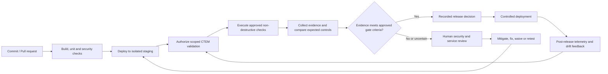

# CTEM and CI/CD Integration — Conceptual Architecture

**Quarter 1 status:** Design and documentation only. This page **does not deliver a working pipeline**, scanner, release gate, or enforcement adapter.

## Goal

Demonstrate where exposure evidence and control validation can inform software delivery decisions without turning a single scanner flag or LLM output into an automatic production block.

## Conceptual workflow

## Separation of responsibilities

- **CI/CD platform:** orchestrates builds and approved checks in permitted environments.
- **Service/application owner:** specifies expected auth/data/business behavior.
- **Security reviewer:** agrees validation plan, interprets evidence and advises decisions.
- **Risk/release authority:** approves exceptions and production release decisions.
- **Telemetry and edge controls:** provide relevant observations; they are not substitutes for app-layer checks.
- **AI assistant (optional):** proposes hypotheses and writes draft summaries; no autonomous release approval.

## Evidence-based gates (future implementation)

A future gate should have documented scope, reproducible assertions, test fixtures, false-positive handling, rollback criteria and exception governance. Unavailable tests and inconclusive outcomes require explicit treatment. **No general rule to “block only confirmed exploitable vulnerabilities” is sufficient on its own**: high-impact unvalidated risks may warrant containment or manual review.

## Four-domain examples (not executable in Q1)

| Domain | Safe conceptual check |
|---|---|
| Web | Regression for session termination and authorization |
| API | Synthetic cross-user request blocked by object-level access checks |
| Mobile | App/client tokens are rejected when revoked |
| AI/LLM | Untrusted retrieved content cannot authorize a privileged tool action |

These examples require approval and project-specific implementation before use.

## Operational safeguards

Define test-only users/data, rate limits, boundaries, scope approval, stop conditions and change-management controls. Do not simulate real payment card fraud or credential attacks against live environments as part of public example pipelines.

## Q1 outcome

This architecture is a **proposal for Q3–Q4 design work**. Q1 only establishes the integration points, decision roles and evidence boundaries. Refer to the [roadmap](../ROADMAP.md).
