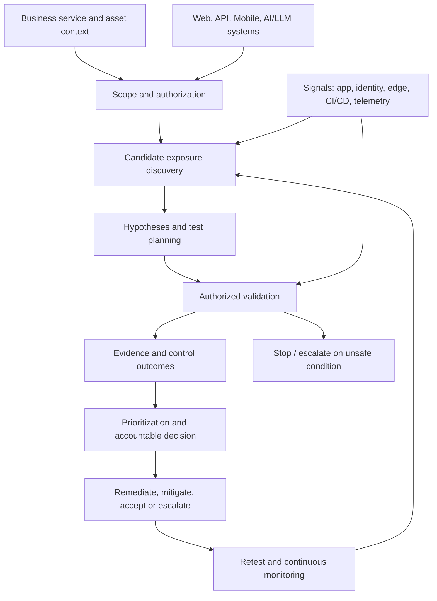

# CTEM Reference Architecture — Conceptual

**Status:** Q1 foundation design. **Not a deployed product or an implementation security guarantee.**

## Purpose

Show how teams can connect diverse application surfaces to discovery inputs, authorized validation, evidence-based risk decisions, and corrective actions. This model is intentionally independent of any cloud, CDN, scanner, programming language or monitoring vendor.

## Conceptual component flow

## Logical components and ownership

| Component | Function | Primary responsibility |
|---|---|---|
| Business context and asset registry | Connects services, owners, dependencies, data and criticality | Service owner |
| Discovery inputs | Supplies observations from tests, inventory, changes, intelligence and telemetry | Security/engineering |
| Hypothesis register | Defines candidate conditions and expected outcomes | AppSec reviewer |
| Validation orchestration | Documents scope, permitted checks and stop conditions | Assessment lead |
| Control evidence | Records security outcomes, limits, confidence and provenance | Tester + control owner |
| Exposure decision | Connects evidence and business impact to treatment | Risk/service owner |
| Remediation and retesting | Executes approved fixes and verifies results | Engineering + security |
| Continuous feedback | Detects changes and reopens relevant questions | Operations + AppSec |

## Four covered domains

**Web:** authorization, authentication, session and workflow integrity.

**API:** gateway controls, identity/tenant boundaries, API inventory and backend enforcement.

**Mobile:** client trust boundaries, application tokens, API access and platform assumptions.

**AI/LLM:** untrusted inputs, output handling, retrieval and tool privileges, confidential data exposure.

Shared CDN/WAF/load balancers can supply **defensive telemetry**, but cannot replace application authorization. An invisible client challenge or risk score alone is not proof of human identity. Mobile and browser clients differ in their feasible controls.

## Trust and privacy boundaries

- Separate public and sensitive evidence stores.
- Treat external telemetry and AI-generated observations as untrusted until reviewed.
- Do not embed customer records, credentials or exploit payloads in example documentation.
- Give CI/CD and validation accounts only approved access.
- Maintain rollback, exception and escalation options for protective controls.

## Evidence flow example

A change in an API route is observed in an inventory and edge log comparison. The application owner approves a staging test using synthetic accounts. The test evidence shows whether authorization checks apply after the change. A risk owner approves mitigation or remediation and the team retests after deployment. The exposure record is updated with a time and confidence level.

## Q1 limits

This is a **reference diagram only**. A runtime scoring engine, edge protection platform, rule-distribution system and executable test suite are proposed later, not built or validated in Q1.

See [CI/CD architecture](ctem-ci-cd-architecture.md), [framework](../docs/ctem-framework.md), [scope](../docs/scope.md).
